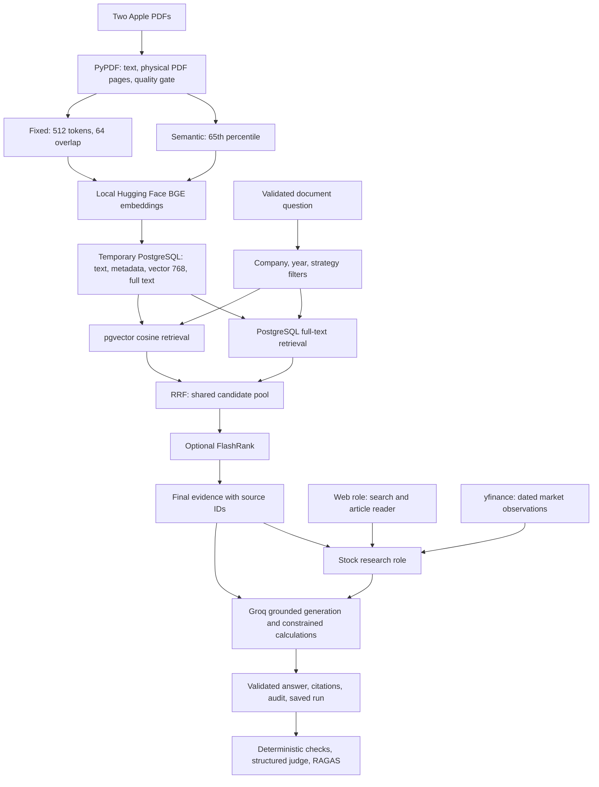

# Financial Document Intelligence: Colab run guide

Open `Financial_Document_Intelligence_Colab.ipynb` in Google Colab. It contains
the application source, setup cells, explanatory notes, and separate example
cells. No repository upload is required. The notebook is delivered unexecuted;
there are no measured retrieval scores or generated financial answers yet.

## Run it step by step

1. Select a T4 GPU runtime when available. A CPU also works more slowly.
2. Run the three installation cells. They preserve the installed PyTorch build.
3. Run the source bootstrap and configuration cells. Add `GROQ_API_KEY` in Colab
   Secrets and allow notebook access. `GROQ_MODEL` and `GROQ_JUDGE_MODEL` are
   optional overrides; the configured model must be available to your account.
   A Hugging Face token is optional for the public embedding model.
4. Run PostgreSQL initialization. This installs PostgreSQL and pgvector inside
   the runtime, creates the demo database, and verifies its 768-dimensional schema.
   Initialization preserves existing demo rows. Reset is a separate explicit cell.
5. Upload `aapl-20240928.pdf` and `aapl-20250927.pdf` using the upload cell.
   Review the extracted income-statement rows and units. The automatic quality
   gate checks selected known values; it cannot certify every table or footnote.
6. Load BGE and ingest both chunking strategies. This downloads model weights
   and writes text, metadata, vectors, and keyword representations to PostgreSQL.
7. Define the four role functions. Set `RUN_DEMOS=True` before running individual
   query cells. Web and stock examples contact external services; filing Q&A uses
   only the uploaded documents as evidence. Groq requests incur your account's
   usage and rate limits.
8. Evaluate a captured answer with `RUN_EVALUATION=True`. Set
   `RUN_COMPARISON=True` separately to generate 40 answers: 10 questions across
   four configurations, followed by RAGAS evaluation. These calls are not free
   merely because the storage is local. Inspect failures before interpreting scores.

## Architecture flow

The document Q&A, web research, stock research, and evaluation roles are application
functions. They share validated result contracts. Search snippets locate articles;
substantive web claims require article content. Stock analysis retains dates so
market observations remain distinct from reported fiscal-year results.

## Where the code and data live

| File or runtime location | Contents |
|---|---|
| `Financial_Document_Intelligence_Colab.ipynb` | Self-contained notebook and explanatory execution cells |
| `financial_rag/demo_schemas.py` | Validated document, tool, answer, citation, calculation, and evaluation contracts |
| `financial_rag/colab_runtime.py` | Colab PostgreSQL/pgvector installation and idempotent initialization |
| `financial_rag/pg_store.py` | Document/chunk/run tables, filtered dense and keyword queries, RRF |
| `financial_rag/colab_demo.py` | PDF checks, token/semantic chunking, LCEL Q&A, controlled comparison |
| `financial_rag/research_agents.py` | Bounded Groq tool loop for web and stock research |
| `financial_rag/demo_evaluation.py` | Captured-answer checks and structured Groq judge |
| `financial_rag/generation.py`, `calculator.py`, `evaluation.py` | Shared grounded generation, Decimal arithmetic, and RAGAS adapter |
| `/content/financial_rag_demo/` | Runtime source, uploaded PDFs, and JSON outputs written by notebook cells |
| PostgreSQL `financial_documents` | Filing identity, title, fiscal year, source URL, and file hash |
| PostgreSQL `financial_chunks` | Page text, strategy, dataset ID, vector, keyword representation, settings |
| PostgreSQL `financial_runs` | Generated answers with exact retained evidence, metadata, settings, and audit |

All Colab runtime files and the local database are temporary. Download desired
JSON results before deleting the runtime. No Pinecone or Agno key is needed.

## How the comparison stays fair

| Configuration | Chunking | Hybrid retrieval | FlashRank |
|---|---|---|---|
| A | Fixed | Enabled | Disabled |
| B | Fixed | Enabled | Enabled |
| C | Semantic | Enabled | Disabled |
| D | Semantic | Enabled | Enabled |

Documents, verified questions, model revision, generator, prompts, filters, candidate
limit of 10, final passage limit of 5, and character budget of 24,000 are held
constant. Each chunking strategy's candidate pool is reused for its reranked
counterpart. Cross-year questions reserve evidence from each requested filing
when available. No live web results enter this comparison. Settings and candidate
IDs are logged; zero temperature does not guarantee identical hosted-model outputs.

Captured evaluation records include citation checks, calculation checks, reference
number coverage, labeled-page recall and reciprocal rank, and timings. Number
coverage is a diagnostic, not proof of correct financial interpretation. The
structured judge reports subjective scores separately. RAGAS reports faithfulness,
context precision, and context recall. Ten questions provide a development check,
not a statistically established winner or a complete numerical accuracy benchmark.

The latest notebook uses a **token** baseline. The existing Pinecone CLI keeps its
previous **character** baseline and three-configuration experiment; their results
must not be treated as directly comparable.

## Validation and limits

Local tests check notebook syntax and unexecuted state, metadata filtering,
chunking contracts, citation validation, and captured-evidence evaluation using
offline fixtures. They do not validate a running Colab database, live web tools,
downloaded models, or hosted generation. Run the notebook to establish those results.
PyPDF layout extraction does not guarantee intact financial tables. The selected
quality gate must be followed by representative human review. Exact pgvector
search is intentional for this small corpus; larger deployments need separate
indexing, persistence, access-control, and performance work.

## Rebuild and dependency management

`python examples/build_colab_notebook.py` regenerates the notebook from the
allowlisted application modules and verified question file. It does not execute
notebook cells. Regenerate after changing bundled modules.

`pyproject.toml` and `uv.lock` include the optional `colab` dependency group for
local development with `uv sync --extra models --extra cloud --extra evaluation
--extra colab`. Colab uses explicit install cells instead of copying the local
virtual environment. It also needs Linux system packages for PostgreSQL and
pgvector; those are outside the Python lockfile.
